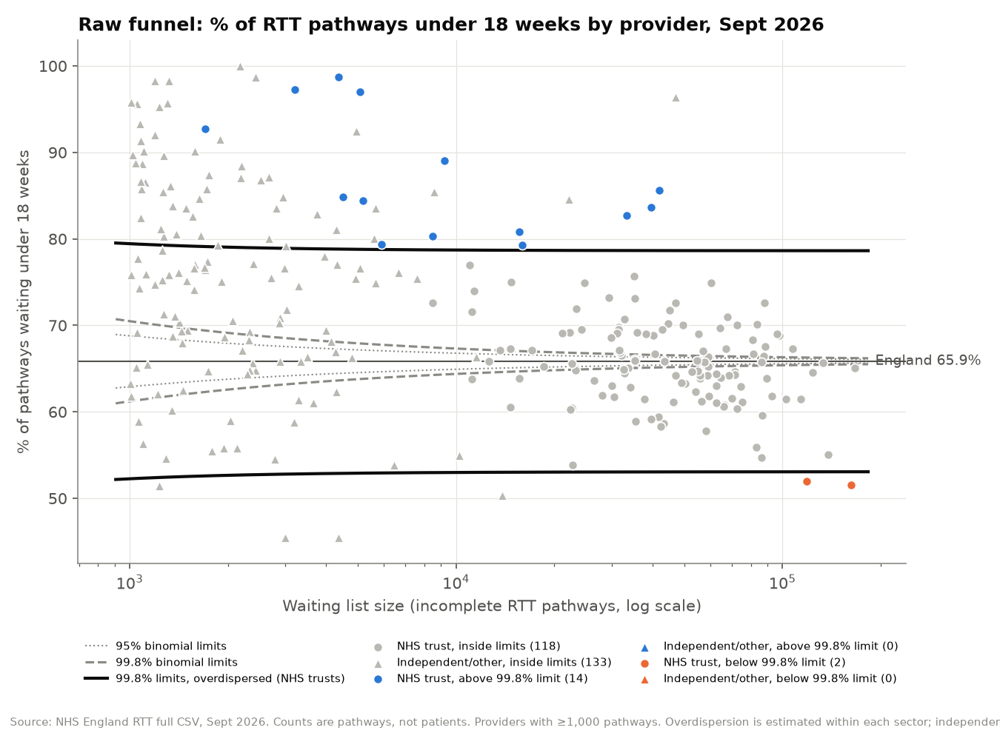
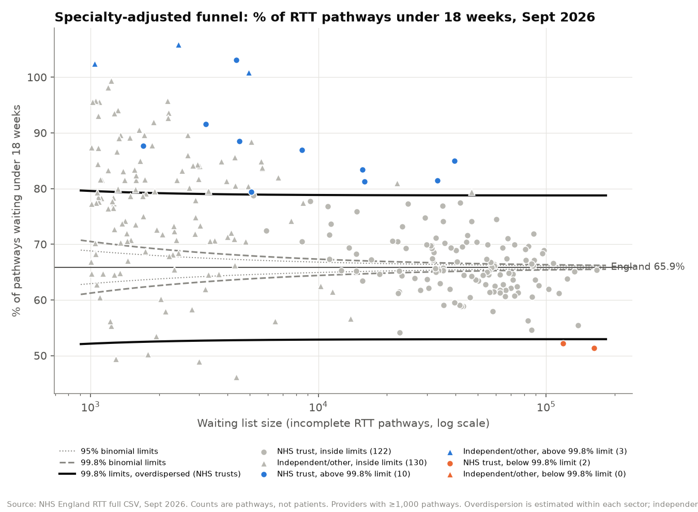
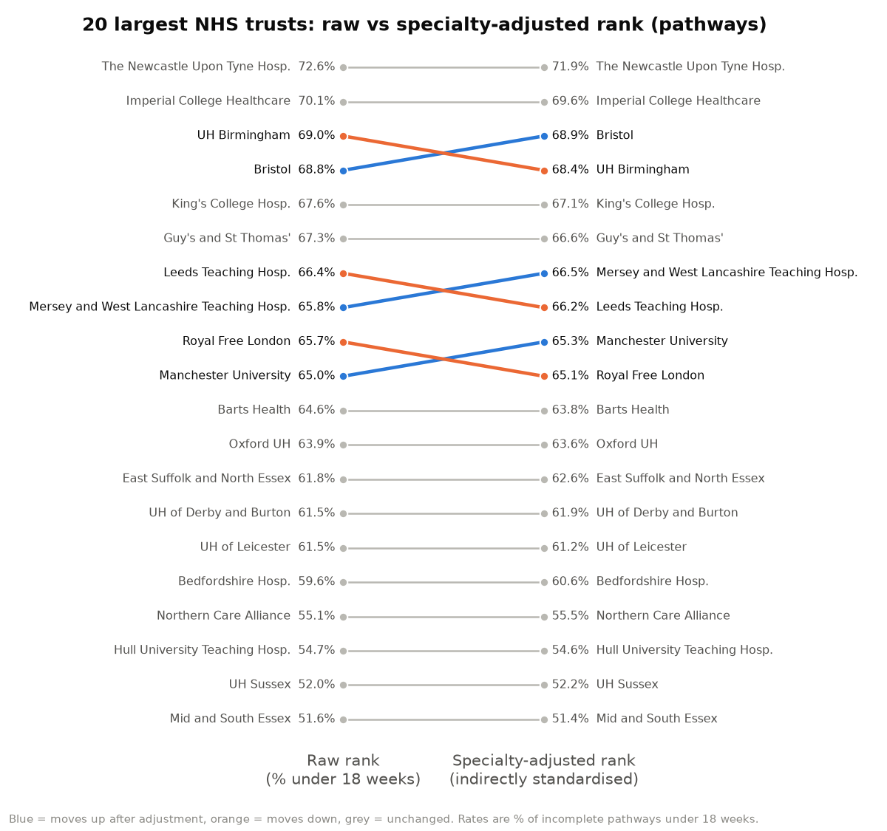
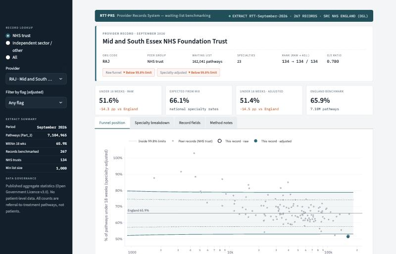

# NHS RTT waiting-list benchmarking

[](https://github.com/hydrograd/nhsRTT_benchmarking/actions/workflows/ci.yml)


**Is a trust's 18-week performance about the trust, or about its specialty mix and its size?**

League tables rank NHS providers on the raw share of referral-to-treatment (RTT) pathways waiting under 18 weeks. That is unfair in two ways:

- **Size.** Small providers swing by chance.
- **Specialty mix.** A trust heavy in specialties with long national waits looks worse than it is.

This repo corrects for both, using NHS England's September 2026 RTT full extract:

- **Funnel plots** handle size. The control limits are adjusted for overdispersion.
- **Indirect standardisation** handles specialty mix.

> **Pathways, not people.** Every count here is an RTT *pathway*. A patient can be on several, so the 7.1 million pathways are roughly 6.2 million patients (NHS England's 85:100 ratio).

> **Data note.** This repo uses published aggregate NHS statistics under the [Open Government Licence v3.0](https://www.nationalarchives.gov.uk/doc/open-government-licence/version/3/). It contains no patient-level data.

## Headline figures (Part_2, incomplete pathways, England, September 2026)

| Measure | This file | Published (reported, no estimates) |
|---|---|---|
| Incomplete pathways | 7,104,965 | 7,074,324 (+0.43%, see below) |
| % within 18 weeks | 65.85% | 65.9% |
| Median wait | 12.19 weeks | 12.2 |
| 92nd-percentile wait | 37.75 weeks | 37.7 (see below) |
| Over 52 weeks | 113,490 | 116,353 *includes estimates*, not comparable |

The percentiles are interpolated linearly within each weekly band.

The 92nd percentile lands on 37.750, right at a rounding boundary. The published figure comes from the provider-based return, whose list is 0.4% smaller, so exact rounding isn't expected. The test allows ±0.06 weeks.

## The three charts

### 1. Raw funnel


### 2. Specialty-adjusted funnel


### 3. Rank shift: the 20 largest NHS trusts


Supplementary charts:

- [Trusts that move most](outputs/figures/rank_shift_biggest_movers.png)
- [Specialty profile](outputs/figures/specialty_profile.png)
- [Observed vs expected](outputs/figures/observed_vs_expected.png)

## Findings

There are 526 providers in the file. 267 have at least 1,000 pathways and are benchmarked: 134 NHS trusts and 133 independent-sector or other providers.

1. **Plain binomial funnel limits are useless at this scale.**
   - 119 of 134 NHS trusts sit outside the 99.8% binomial limits. With lists of around 100,000 the limits have almost no width.
   - Real variation between trusts, beyond chance, has a standard deviation of about 4.1 percentage points. That was estimated with Spiegelhalter's (2005) additive overdispersion method, within each sector.
   - On those limits, 16 trusts are outside 99.8% on raw rates and 12 after specialty adjustment. Ten are above and two below.
   - The two below the limits are Mid and South Essex (51.6%) and University Hospitals Sussex (52.0%). They stay below whichever way you measure.
2. **Specialty mix barely matters for large acute trusts, but matters a lot for specialist and community trusts.**
   - For the 20 largest trusts, the mix-expected rate spans only 64.8–66.7%. Six swap places by one rank and none moves further.
   - Across all 134 trusts the expected rate ranges from 60.9% to 80.4%, and 54 trusts move 5 or more places.
   - Those big rank moves come from small rate changes. For example, Sussex Community moves 40 places on a 4-point change, because the middle of the table is crowded.
   - Adjustment takes four specialist trusts back inside the 99.8% limits, because their high raw rates partly reflect specialties that are quick nationally: Moorfields, Royal Papworth, Liverpool Heart and Chest, and Midlands Partnership.
3. **Long waits are concentrated.**
   - The 10 providers with the most 52-week-plus pathways hold 36.5% of the national total.
   - Mid and South Essex alone holds 11.6%.
   - By specialty, trauma and orthopaedics holds 19.3%.

"Outside the 99.8% limits" means unlikely to be chance at that list size. It does not mean "failing". This data cannot explain causes.

Full write-up: [REPORT.md](REPORT.md).

## Dashboard



`app.py` is a Streamlit dashboard styled as a provider records system. Look up any of the 267 benchmarked providers by org code or name to see:

- **Provider record:** org code, peer group, list size, number of specialties, rank within the peer group (raw → adjusted) and O/E ratio, with funnel-status flags.
- **Readings:** raw rate, the rate expected from specialty mix, the adjusted rate and the England benchmark.
- **Funnel position:** where the provider sits against its peer group's overdispersion-adjusted 95% and 99.8% limits. Hover over any point to see that provider.
- **Specialty breakdown:** the provider's gap to the England rate in each specialty, with list share.
- **Record fields:** every derived value with its definition, exportable as CSV.

The sidebar filters providers by peer group (NHS trust or independent sector) and by funnel flag.

The app reads only the small committed tables in `outputs/tables/`, so it runs without the 83 MB extract:

```bash
streamlit run app.py
```

<!-- Live app: add the streamlit.app link here once deployed -->

## Data traps handled (each has a test in `tests/test_data_traps.py`)

| Trap | Handling |
|---|---|
| `C_999` "Total" rows duplicate the specialty rows | Kept in a separate table. A test shows that summing everything doubles the list. |
| Five RTT parts | Only Part_2 is the waiting list. Part_2A is a subset of Part_2 and is never added. |
| Part_2 `Total` column is blank | Totals are built from the week bands. `Total All` is used only as a check (they match on every row). |
| Unknown clock starts | These exist only in completed parts (86 admitted, 830 non-admitted). They are reported separately and excluded from percentiles. |
| One row per commissioner | Data is aggregated to provider before benchmarking. |

**Data-quality exception found.** Regency Eye Hospital (AW7) has more Part_2A pathways (7) than Part_2 (6). Commissioner 14L has three Part_2A pathways but no Part_2 row. It's recorded in `config.yaml` under `known_data_issues`, and the test fails on any *new* violation.

## Open questions (reconciliation)

These are unresolved, so no 65-, 78- or 104-week figure here is quoted as "the national number".

- **Why is the full extract about 0.4% above the published figures?** The gap is similar across all parts: +0.43% incomplete, +0.42% admitted, +0.35% non-admitted, +0.36% new periods. That points to a structural difference, not noise.
  - The published headline uses the provider-based return. This file is the commissioner-based return.
  - The file includes 37,419 Part_2 pathways from commissioners with no parent organisation (`NONC` and `Y56`–`Y63` codes). It also includes 124,700 pathways under specialised commissioning hubs.
  - Neither number equals the 30,641 gap. *To do: read NHS England's RTT guidance on commissioner-based vs provider-based data.*
- **Why are the long-wait counts above the published ones?** The file has 648 pathways over 104 weeks, against 314 published even with estimates.
  - The Robert Jones and Agnes Hunt Orthopaedic Hospital alone reports 309 of the 648.
  - It's possible that provider's commissioner-based submission differs from its provider-based one. Unverified.

## Missing trusts

Six trusts submitted no September 2026 data, so national totals exclude them. Sheffield Teaching Hospitals NHS Foundation Trust and Nottingham University Hospitals NHS Trust are confirmed absent from the file. *TODO: add the other four from the press notice.*

## Method

- **Indirect standardisation.** Expected within-18 for provider *j* is the sum over specialties *s* of its pathways in *s* times the national rate for *s*: E_j = Σ_s n_js · p_s.
  - O/E = O_j / E_j. The adjusted rate is O/E × the national rate.
  - England's O/E is exactly 1 (tested).
  - Adjusted rates can exceed 100% for providers well above their expected rate. That is a known property of the method.
- **Funnel limits.** Binomial limits are p ± z·√(p(1−p)/n), with z = 1.96 (95%) or 3.09 (99.8%).
  - Overdispersed limits add τ² inside the square root, estimated from 10%-winsorised z-scores (Spiegelhalter 2005, *Stat Med* 24:1185).
  - τ² is estimated separately for NHS trusts (SD 4.1 pp) and independent providers (SD 11–13 pp), because they are different peer groups.

## Repo layout

```
config.yaml              period, min list size (1,000), control limits, published figures
scripts/download.py      fetches the extract from NHS England (the 83 MB CSV is not committed)
scripts/run_analysis.py  builds Parquet, runs everything, writes outputs/
src/rtt/load.py          read and reshape to long Parquet; C_999 kept separate
src/rtt/checks.py        integrity and reconciliation checks
src/rtt/metrics.py       % within 18 weeks, interpolated percentiles, long waits
src/rtt/benchmark.py     funnel limits, overdispersion, indirect standardisation, rank shift
src/rtt/plots.py         charts
tests/                   method tests (synthetic) and data-trap tests (real extract)
app.py                   Streamlit dashboard (provider records view)
.streamlit/config.toml   dashboard theme
.github/workflows/ci.yml downloads the extract and runs the tests on every push
outputs/                 tables (CSV), figures, summary.json
```

## Reproduce

Requires Python 3.12.

```bash
pip install -r requirements.txt
python scripts/download.py        # or copy the CSV into data/raw/
python scripts/run_analysis.py
python -m pytest -q                # 19 tests: methods + one per data trap
streamlit run app.py
```

CI runs the same steps on GitHub Actions, including the download, so the data-trap tests run against the real extract.

## Licence and data

The data is © NHS England, published under the [Open Government Licence v3.0](https://www.nationalarchives.gov.uk/doc/open-government-licence/version/3/). It is aggregate statistics only, with no patient-level data. Source: NHS England, *Referral to Treatment (RTT) Waiting Times*, September 2026 full CSV extract.
